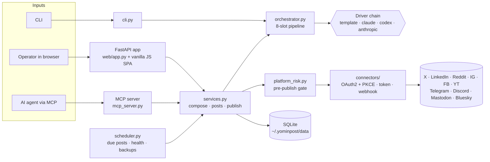

# YominPost

> **One piece of material in, platform-native posts out. Reviewed, risk-checked, scheduled and published from a studio you host yourself.**
>
> 一份素材 → 每个渠道一版地道的帖子 → 发布前风控检查 → 排期 / 发布。自托管，默认零配置、无需任何 API Key。

Web app · CLI (`yominpost`) · MCP server (`yominpost-mcp`) · Agent Skill (`skill/SKILL.md`) · MIT

By [Yomin Ma](https://yomin.love) · GitHub [@mrlong0129](https://github.com/mrlong0129) · Sister projects: [wechat-article-fetcher](https://github.com/mrlong0129/wechat-article-fetcher), [agent-web-fetch](https://github.com/mrlong0129/agent-web-fetch) · [中文说明](#中文说明)

## Quick start

No install and no config. All you need is [uv](https://docs.astral.sh/uv/) (`curl -LsSf https://astral.sh/uv/install.sh | sh`):

```bash
# 1) Start the studio (web UI on http://127.0.0.1:8300, data in ~/.yominpost/)
uvx --from git+https://github.com/mrlong0129/yominpost yominpost --open

# 2) Or generate posts straight from the terminal
uvx --from git+https://github.com/mrlong0129/yominpost yominpost run \
  --brand "Acme" --source "Acme turns one long-form idea into ten platform-native posts." \
  --platform x --platform linkedin --platform tiktok --topics 3

# 3) Claude Code: register the MCP server in one line
claude mcp add yominpost -- uvx --from git+https://github.com/mrlong0129/yominpost yominpost-mcp
```

**Cursor**: add this to `~/.cursor/mcp.json` (global) or `.cursor/mcp.json` (project):

```json
{
  "mcpServers": {
    "yominpost": {
      "command": "uvx",
      "args": ["--from", "git+https://github.com/mrlong0129/yominpost", "yominpost-mcp"]
    }
  }
}
```

**Agent Skill** (teaches Claude Code / Cursor how to write, check and hand off social posts with YominPost):

```bash
# Claude Code
mkdir -p ~/.claude/skills/yominpost && curl -fsSL https://raw.githubusercontent.com/mrlong0129/yominpost/main/skill/SKILL.md -o ~/.claude/skills/yominpost/SKILL.md
# Cursor
mkdir -p ~/.cursor/skills/yominpost && curl -fsSL https://raw.githubusercontent.com/mrlong0129/yominpost/main/skill/SKILL.md -o ~/.cursor/skills/yominpost/SKILL.md
```

Instructions for coding agents live in [AGENTS.md](AGENTS.md).

## Why

Posting the same idea to X, LinkedIn, Instagram, TikTok and Telegram means rewriting it five times, guessing which format each platform wants, and hoping the AI-written version doesn't get the account flagged. Hosted schedulers lock your tokens and drafts in someone else's cloud, and most AI writers stop at "here is a caption".

YominPost does the whole loop on your own machine:

- **It decides the format, not just the words.** A rule-based router picks text, thread, image post, carousel or short video per platform and explains why.
- **It critiques its own drafts.** Every draft is scored and rewritten once if it misses the bar.
- **It protects the account.** A pre-publish risk gate catches leaked prompts, engagement bait, hashtag stuffing, duplicate posts and unsafe posting cadence. These are the signals that get AI-assisted accounts restricted.
- **It actually publishes.** Real OAuth2 + PKCE connectors, encrypted tokens, a scheduler that fires on time and never double-posts.

## Features

| | |
|---|---|
| **8-slot content engine** | Brand DNA → trends → ideation & calendar → format router → copy → visual (SVG/JPG poster) → short-video storyboard + SRT → QA self-critique |
| **Post Creating Loop** | Paste text, a URL or image links → analysis → research → strategy → one draft per channel, shown on an infinite canvas with chat-style refinement |
| **Swappable drivers** | `template` (offline, deterministic, default) · `claude_code` (local `claude` CLI) · `codex` (local `codex` CLI) · `agy` · `anthropic` (API). Automatic fallback chain, so a failing driver never breaks a run |
| **Real publishing** | X, LinkedIn, Reddit, Facebook Page, Instagram, YouTube Shorts, Discord, Mastodon (zero-config app registration), Telegram, Bluesky, Webhook. TikTok, Xiaohongshu, Threads and Pinterest are simulated for now |
| **Pre-publish risk gate** | Prompt-leak and engagement-bait lint, hashtag/link limits, duplicate detection, per-platform cadence caps, auto-freeze after a platform block |
| **Operations** | Calendar (week/list), scheduled queue with retry, asset library, topic bank, per-channel health (native signals such as karma, strikes and account status), daily channel sync |
| **Self-hosted and safe by default** | FastAPI + SQLite, no build step. Fernet-encrypted tokens, operator access key (required for public deploys), SSRF-guarded URL fetching, daily backups |
| **Agent-native** | MCP tools `generate_posts`, `check_post`, `save_draft`, `list_posts`, `list_platforms`. There is deliberately no publish tool: a human approves in the UI |

## Architecture



Data model, storage and security details: [ARCHITECTURE.md](ARCHITECTURE.md) (Chinese). Platform risk research: [docs/PLATFORM_RISK.md](docs/PLATFORM_RISK.md). Registering OAuth apps: [docs/REGISTER_APPS.md](docs/REGISTER_APPS.md). Public deployment through Cloudflare Tunnel: [deploy/DEPLOY.md](deploy/DEPLOY.md).

## Configuration

Defaults need nothing. Everything is optional and set through environment variables (see [`.env.example`](.env.example)):

| Variable | What it does |
|---|---|
| `YOMINPOST_PROVIDER` | `template` (default) · `claude_code` · `codex` · `agy` · `anthropic` |
| `ANTHROPIC_API_KEY` | Enables the `anthropic` driver |
| `OPENAI_API_KEY` / `YOMINPOST_IMAGE_BASE_URL` | Real image generation (gpt-image, any OpenAI-compatible endpoint) |
| `X_CLIENT_ID`, `LINKEDIN_CLIENT_ID`, … | OAuth apps for one-click Connect (or paste them once on the Settings page) |
| `YOMINPOST_HOME` | Data root, default `~/.yominpost` |
| `YOMINPOST_PUBLIC_URL` + `YOMINPOST_ACCESS_KEY` | Public deployment. The app refuses to start publicly without an access key |

## FAQ

**Do I need an API key?** No. The default `template` driver runs offline and deterministically, so you can try the whole flow and run the test suite with zero keys. For production-quality copy, switch to `claude_code` or `codex` (uses the CLI you are already logged into) or `anthropic`.

**Is the offline output good enough to post?** It is a solid scaffold that follows your material's language, not a replacement for a real model. Use it to try the workflow, then plug in a driver.

**Can the MCP server publish for me?** No, and that's on purpose. Agents can generate, check and save drafts; you review and press Publish in the UI. Publishing goes out under your real accounts and can't be undone.

**Where is my data?** In `~/.yominpost/` (SQLite DB, encryption key, generated posters). Back up `data/.secret.key` together with the DB, or stored OAuth tokens can't be decrypted.

**Which platforms really publish?** X, LinkedIn, Reddit, Facebook Page, Instagram, YouTube Shorts, Discord, Mastodon, Telegram, Bluesky and Webhook. TikTok, Xiaohongshu, Threads and Pinterest use a simulated connector until their APIs are wired in.

**What language is the UI?** The web UI is currently in Chinese. Generated copy follows your material (English in, English out) or `--language en|zh`. An English UI is on the roadmap; PRs welcome.

**How is this different from Postiz / Buffer?** Same "connect → compose → schedule → publish" backbone, plus an AI content engine that picks formats and critiques itself, a platform-risk gate built for AI-assisted posting, and an MCP server so coding agents can draft for you. It is a single-user, self-hosted Python app, not a SaaS.

## Development

```bash
git clone https://github.com/mrlong0129/yominpost && cd yominpost
uv venv && uv pip install -e ".[dev]"
.venv/bin/pytest -q            # offline, no keys needed
.venv/bin/yominpost serve      # or ./run.sh
```

Code map: `yominpost/stages/` (8 slots), `orchestrator.py` (pipeline), `services.py` (compose / posts / publish), `connectors/` + `oauth_specs.py` + `oauth_flow.py` (platforms), `platform_risk.py` (risk gate), `scheduler.py`, `web/` (FastAPI + SPA), `mcp_server.py`, `cli.py`.

## 中文说明

YominPost 是一个**自托管的 AI 社媒工作台**：把一份素材（文字、链接、图片）交给它，它会为每个渠道判断合适的形式（文本 / thread / 图文 / 轮播 / 短视频），写出地道的文案，自己打分、不达标就重写一次，发布前再过一遍平台风控（prompt 残留、诱导互动、堆标签、重复内容、发帖频率），最后通过真实 OAuth 连接器排期或发布。

- **零配置**：`uvx --from git+https://github.com/mrlong0129/yominpost yominpost --open`，不用装、不用 Key，默认离线模板驱动；想要更好的文案就切到本机已登录的 `claude` / `codex` CLI 或 Anthropic API。
- **给 Agent 用**：`claude mcp add yominpost -- uvx --from git+https://github.com/mrlong0129/yominpost yominpost-mcp`，提供生成、风控检查、存草稿等工具；**刻意不提供发布工具**，发布由人在界面里确认。
- **真实发布**：X、LinkedIn、Reddit、Facebook 主页、Instagram、YouTube Shorts、Discord、Mastodon、Telegram、Bluesky、Webhook；抖音/TikTok、小红书、Threads、Pinterest 目前为模拟连接器。
- 数据都在本机 `~/.yominpost/`，令牌 Fernet 加密；公网部署必须设置访问密钥。界面目前是中文。

## License

MIT © 2026 [Yomin Ma](https://yomin.love)
